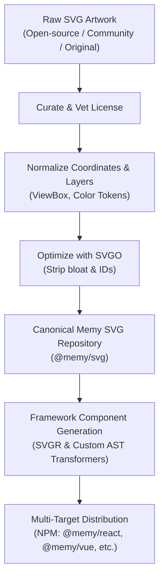

# Memy

<p align="center">
  <strong>UI illustrations as simple and developer-friendly as icons.</strong>
  <br />
  <em>The open-source, framework-agnostic illustration library — "Lucide for illustrations."</em>
</p>

<p align="center">
  <a href="#quick-start">Quick Start</a> •
  <a href="#why-memy">Why Memy</a> •
  <a href="#component-api">Component API</a> •
  <a href="#animation-mechanics--architecture">Animation Mechanics</a> •
  <a href="#architecture--ecosystem">Architecture</a> •
  <a href="#initial-illustration-catalog">Catalog</a> •
  <a href="#roadmap--milestones">Milestones</a> •
  <a href="#license">License</a>
</p>

---

## Overview

In modern web development, sourcing and integrating UI illustrations is unnecessarily painful: developers download random SVGs, wrestle with oversized viewBoxes, manually clean messy XML, hardcode colors, and repeat the same boilerplate across projects.

**Memy** eliminates this friction. Just like icon sets (such as Lucide or Heroicons), Memy treats illustrations as lightweight, plug-and-play components.

```tsx
import { EmptyCart, NotFound } from "@memy/react";

export function ErrorState() {
  return (
    <div className="flex flex-col items-center justify-center p-8">
      <NotFound
        animated
        color="#00D4FF"
        secondaryColor="#001014"
        className="w-64 h-64"
      />
      <h2 className="text-xl font-bold mt-4">Page Not Found</h2>
    </div>
  );
}
```

No downloading SVG files. No manual XML cleanup. Just clean, typed components ready for your design system.

---

## Key Features

- 🎨 **Minimal, Focused API**: No bloated config matrices or arbitrary sizing props. Control scale via standard CSS (`className`) and customize with primary/secondary colors.
- ⚡ **Dynamic Micro-Animations**: Smooth, lightweight CSS animations enabled with a simple `animated` prop.
- 🌐 **Framework Agnostic Source of Truth**: SVGs are the canonical foundation. Official packages are generated for React, Vue, Svelte, Angular, React Native, and raw SVG.
- 🌲 **Tree-Shakable & Featherweight**: Zero runtime overhead; bundle only the exact illustrations your app imports.
- 🛡️ **Permissively Licensed**: Free and open source under the MIT License, preserving attribution for open-source artwork.

---

## Quick Start

### Installation

Install the package for your framework using your favorite package manager:

```bash
# pnpm (recommended)
pnpm add @memy/react

# npm
npm install @memy/react

# yarn
yarn add @memy/react

# bun
bun add @memy/react
```

### Ways to Consume Memy

Memy offers **three distinct ways** to get illustrations into your project, giving every developer and designer maximum flexibility:

| Method | Best For | Output Location | Dependencies Added | Frameworks |
| :--- | :--- | :--- | :--- | :--- |
| 📦 **NPM Packages**<br>*(The Lucide Way)* | Apps using multiple illustrations across routes | `node_modules/` | `@memy/<framework>` | React, Vue, Svelte, etc. |
| 📋 **CLI Component Scaffolding**<br>*(The shadcn Way)* | Using 1–3 illustrations; full code ownership & direct customization | `components/memy/` | **Zero** (self-contained source file) | **React, Vue, Svelte, Solid, Raw SVG** |
| 🌐 **Web Showcase (`memy.dev`)**<br>*(100% Framework Agnostic)* | Designers, quick prototypes, HTML, Astro, Figma | Clipboard / `.svg` file | **Zero** (pure vector XML) | All tools & frameworks |

---

#### 1. Official Framework Packages (NPM — "The Lucide Way")

Install the official package for your framework. Components reside in `node_modules` with strict `"sideEffects": false` tree-shaking—your final production bundle only includes the illustrations you import.

```bash
# React
pnpm add @memy/react

# Vue
pnpm add @memy/vue

# Svelte
pnpm add @memy/svelte
```

```tsx
import { NotFound, EmptyCart } from "@memy/react";

export function Example() {
  return <NotFound animated color="#2563eb" secondaryColor="#f9fafb" className="w-64 h-64" />;
}
```

---

#### 2. Direct Component Source Code ("The shadcn Way" for Every Framework)

> **Don't want to install an npm package? Only need one or two illustrations? Want full source code ownership to edit paths, styles, or props directly?**

Just like [shadcn/ui](https://ui.shadcn.com/) revolutionized React by copying component code directly into your repository instead of installing heavy black-box dependencies, **Memy provides this exact same experience for every major framework**:

- **React developers**: grab a native `.tsx` component.
- **Vue developers**: grab a native `.vue` Single File Component (SFC with `<script setup>`).
- **Svelte developers**: grab a native `.svelte` component.
- **Solid developers**: grab a native `.tsx` component.
- **Static / Vanilla**: grab the standalone `.svg` vector file.

All generated component files are **completely self-contained**—they have **zero external runtime dependencies** beyond your framework itself!

##### Add Components via the Memy CLI:

```bash
# React: creates components/memy/NotFound.tsx
pnpm dlx memy add not-found --framework react

# Vue: creates components/memy/NotFound.vue
pnpm dlx memy add not-found --framework vue

# Svelte: creates components/memy/NotFound.svelte
pnpm dlx memy add not-found --framework svelte

# Raw SVG: creates components/memy/NotFound.svg
pnpm dlx memy add not-found --svg
```

##### What the Scaffolder Copies into Your Project:

<details>
<summary><b>View React Component (<code>components/memy/NotFound.tsx</code>)</b></summary>

```tsx
import type { SVGProps } from "react";

export interface NotFoundProps extends SVGProps<SVGSVGElement> {
  animated?: boolean;
  color?: string;
  secondaryColor?: string;
  className?: string;
}

export function NotFound({
  color = "currentColor",
  secondaryColor = "transparent",
  animated = false,
  className = "",
  style,
  ...props
}: NotFoundProps) {
  return (
    <svg
      viewBox="0 0 400 300"
      fill="none"
      xmlns="http://www.w3.org/2000/svg"
      className={["memy-svg", animated ? "memy-animated" : "", className].filter(Boolean).join(" ")}
      data-animated={animated ? "true" : undefined}
      style={{ display: "block", ...style }}
      role="img"
      aria-label="NotFound illustration"
      {...props}
    >
      {animated && (
        <style>
          {`
            @keyframes memy-notfound-float {
              0%, 100% { transform: translateY(0px) rotate(0deg); }
              50% { transform: translateY(-8px) rotate(1deg); }
            }
            svg.memy-animated .memy-notfound-body {
              transform-box: fill-box;
              transform-origin: center;
              animation: memy-notfound-float 3s ease-in-out infinite;
            }
            /* ... bespoke illustration keyframes & reduced-motion queries ... */
          `}
        </style>
      )}
      {/* Self-contained SVG paths */}
    </svg>
  );
}
```
</details>

<details>
<summary><b>View Vue Component (<code>components/memy/NotFound.vue</code>)</b></summary>

```vue
<script setup lang="ts">
withDefaults(
  defineProps<{
    animated?: boolean;
    color?: string;
    secondaryColor?: string;
    class?: string;
  }>(),
  {
    animated: false,
    color: "currentColor",
    secondaryColor: "transparent",
    class: "",
  }
);
</script>

<template>
  <svg
    viewBox="0 0 400 300"
    fill="none"
    xmlns="http://www.w3.org/2000/svg"
    :class="['memy-svg', animated ? 'memy-animated' : '', $props.class]"
    :data-animated="animated ? 'true' : undefined"
  >
    <style v-if="animated">
      @keyframes memy-notfound-float {
        0%, 100% { transform: translateY(0px); }
        50% { transform: translateY(-8px); }
      }
      svg.memy-animated .memy-notfound-body {
        transform-box: fill-box;
        transform-origin: center;
        animation: memy-notfound-float 3s ease-in-out infinite;
      }
    </style>
    <!-- Self-contained SVG markup -->
  </svg>
</template>
```
</details>

<details>
<summary><b>View Svelte Component (<code>components/memy/NotFound.svelte</code>)</b></summary>

```svelte
<script lang="ts">
  export let animated: boolean = false;
  export let color: string = "currentColor";
  export let secondaryColor: string = "transparent";
  export let className: string = "";
</script>

<svg
  viewBox="0 0 400 300"
  fill="none"
  xmlns="http://www.w3.org/2000/svg"
  class={["memy-svg", animated ? "memy-animated" : "", className].filter(Boolean).join(" ")}
  data-animated={animated ? "true" : undefined}
  {...$$restProps}
>
  {#if animated}
    <style>
      @keyframes memy-notfound-float {
        0%, 100% { transform: translateY(0px); }
        50% { transform: translateY(-8px); }
      }
      svg.memy-animated .memy-notfound-body {
        transform-box: fill-box;
        transform-origin: center;
        animation: memy-notfound-float 3s ease-in-out infinite;
      }
    </style>
  {/if}
  <!-- Self-contained SVG markup -->
</svg>
```
</details>

You can also copy files directly from the repository's packages folder (`packages/<framework>/src/illustrations/`) into your codebase manually if you prefer not to use the CLI.

---

#### 3. Interactive Web Showcase (100% Framework Agnostic)

Visit the official web gallery at **`memy.dev`**:

- 🎨 **Live Customizer**: Test brand colors, secondary accents, and toggle micro-animations dynamically on any illustration.
- 📋 **"Copy SVG"**: One-click copy of the clean, normalized SVG XML directly to your clipboard. Paste it directly into JSX, HTML, Astro, Svelte, Vue, or Figma.
- ⬇️ **"Download SVG"**: Instant download of the standalone, optimized `.svg` file.

> **Why doesn't the website supply framework-specific TSX snippets?**
> The website is designed to be **strictly framework-agnostic**. Providing only React snippets would create framework bias and leave Vue, Svelte, Angular, Solid, and mobile developers as second-class citizens. Instead, the web showcase provides pure, standardized SVG vectors—ensuring zero vendor lock-in, zero hosting overhead, and 100% universal compatibility across every tool and language. Framework components are cleanly handled via NPM packages and the CLI scaffolder.

### Basic Usage

```tsx
import { NotFound } from "@memy/react";

function App() {
  return <NotFound />;
}
```

### Styled and Animated

```tsx
import { EmptyInbox } from "@memy/react";

function InboxEmptyState() {
  return (
    <EmptyInbox
      animated
      color="#6366F1"
      secondaryColor="#EEF2FF"
      className="w-72 h-72 mx-auto"
    />
  );
}
```

---

## Component API

Memy intentionally keeps the component interface minimal and predictable across all illustrations:

```tsx
<Illustration
  animated={false}              // Optional: enables built-in micro-animations
  color="currentColor"          // Optional: primary brand/illustration color
  secondaryColor="transparent"  // Optional: secondary accents/background fills
  className="w-64 h-64"         // Optional: controls dimensions and CSS styles
  {...svgProps}                 // Standard SVG HTML attributes (aria-*, role, etc.)
/>
```

### Props Specification

| Prop | Type | Default | Description |
| :--- | :--- | :--- | :--- |
| `animated` | `boolean` | `false` | Toggles subtle, lightweight micro-animations. |
| `color` | `string` | `"currentColor"` | Primary accent/fill/stroke color. |
| `secondaryColor` | `string` | `undefined` | Secondary accent or background fill color. |
| `className` | `string` | `""` | CSS classes to control dimensions (`width`, `height`), positioning, and effects. |

> **Design Note:** Memy intentionally omits custom `size` props or complex color-token systems. Sizing is delegated to standard CSS / Tailwind classes (`w-48 h-48`), ensuring seamless responsiveness.

---

## Animation Mechanics & Architecture

Memy does not use external animation libraries (such as Framer Motion or GSAP) or heavy JavaScript runtime requestAnimationFrame loops. Instead, Memy uses an **SVG-First CSS Motion Engine** that delivers 60fps GPU-accelerated micro-animations with **zero JavaScript runtime overhead**:

### 1. Self-Contained Raw Vector Stylesheets
Every illustration owns its unique motion system authored directly inside its canonical `.svg` file in [`packages/svg/src/`](file:///c:/Code/memy/packages/svg/src). Rather than forcing every illustration into a generic "float" animation, each illustration defines motion bespoke to its narrative:
- **`EmptyCart`**: Shopping cart basket floats, ground shadow dynamically expands/fades, empty question bubble bobs, and wheels rock back and forth.
- **`NotFound`**: Floating 404 monitor tilts gently, shadow breathes, 404 badge floats, and eyes blink realistically every 4 seconds.
- **`WomanLaptopSitting`**: Left and right indoor plants shake and sway, typing dots in the input bar dance in a continuous traveling wave, the laptop screen pulses with light, the woman's head nods gently, and her hand taps in a brisk typing rhythm.

### 2. How the Switch ON / OFF Works
All animation keyframes are gated by root selectors:

```css
svg.memy-animated .memy-element,
svg[data-animated="true"] .memy-element {
  animation: memy-keyframe-name 2s ease-in-out infinite;
}
```

* **When `animated={false}` (default)**:
  * The `<style>` tag is omitted from the DOM entirely.
  * No `.memy-animated` class or `data-animated` attribute is placed on `<svg>`.
  * **Result**: 0% CPU/GPU overhead. The illustration is completely static.
* **When `animated={true}`**:
  * The stylesheet is injected, and the root `<svg>` receives `className="memy-svg memy-animated"` and `data-animated="true"`.
  * Keyframe animations immediately activate via the GPU.
* **When Downloaded as Standalone `.svg`**:
  * The standalone `.svg` has `class="memy-animated" data-animated="true"` by default.
  * Opens pre-animated out of the box when dragged into Chrome, Figma, Penpot, or embedded in an `` tag!

### 3. Cross-Browser Transform Rules
SVG transforms can distort or rotate around unexpected coordinates if not properly constrained. Memy strictly enforces:
```css
transform-box: fill-box;
transform-origin: center; /* or '50% 100%' for plants pivoting from their pots */
```
This guarantees that vector transforms calculate relative to the element's own bounding box, delivering pixel-perfect, consistent animation across Chrome, Safari, Firefox, and Edge.

### 4. Accessibility First (`prefers-reduced-motion`)
Every animated Memy illustration automatically embeds:
```css
@media (prefers-reduced-motion: reduce) {
  svg.memy-animated *,
  svg[data-animated="true"] * {
    animation: none !important;
  }
}
```
Users who have requested reduced motion in their system settings are protected by default across all frameworks and static SVGs.

---

## Architecture & Ecosystem

React is not the source of truth—the **normalized SVG illustration** is. Framework-specific packages are code-generated from this single canonical SVG source.

```
Memy Ecosystem
│
├── SVG Source (packages/svg) ───────── Normalized, optimized canonical artwork
│
├── React (@memy/react) ─────────────── First-class React component library
├── React Native (@memy/react-native) ─ Native mobile vector illustrations
├── Vue (@memy/vue) ─────────────────── Vue 3 SFC wrappers
├── Svelte (@memy/svelte) ───────────── Svelte 4/5 component wrappers
├── Angular (@memy/angular) ─────────── Angular standalone components
└── Raw SVG (@memy/svg) ─────────────── Direct optimized SVGs for static sites
```

### Build Pipeline



---

## Initial Illustration Catalog

The v0.1 release focuses on the most critical empty states, error screens, and application feedback indicators:

### 1. Errors & System States
| Illustration | Component Name | Common Use Case |
| :--- | :--- | :--- |
| **Not Found** | `<NotFound />` | 404 routes, missing resources |
| **Server Error** | `<ServerError />` | 500 error boundaries, backend crashes |
| **Forbidden** | `<Forbidden />` | 403 authorization and permission denials |
| **Offline** | `<Offline />` | Network loss, disconnected state |

### 2. Empty States
| Illustration | Component Name | Common Use Case |
| :--- | :--- | :--- |
| **Empty Cart** | `<EmptyCart />` | E-commerce shopping bag with zero items |
| **Empty Inbox** | `<EmptyInbox />` | Zero messages or cleared notification center |
| **Empty Folder** | `<EmptyFolder />` | Empty file directory or project workspace |
| **No Results** | `<NoResults />` | Filter or search queries yielding zero matches |
| **No Notifications** | `<NoNotifications />` | Cleared user alert feeds |

### 3. Feedback & Operations
| Illustration | Component Name | Common Use Case |
| :--- | :--- | :--- |
| **Success** | `<Success />` | Successful submissions, payment confirmations |
| **Failed** | `<Failed />` | Transaction rejects, validation errors |
| **Processing** | `<Processing />` | Asynchronous operations, loading steps |
| **Maintenance** | `<Maintenance />` | Scheduled downtime, platform updates |

### 4. Actions & Flow
| Illustration | Component Name | Common Use Case |
| :--- | :--- | :--- |
| **Upload** | `<Upload />` | Drag-and-drop file uploaders |
| **Download** | `<Download />` | Export hubs, asset download prompts |
| **Search** | `<Search />` | Global search dialogs and query modals |
| **Create** | `<Create />` | Onboarding dialogs and new entity triggers |

---

## Asset Sources & Licensing

Memy expands its illustration collection through three responsible channels:
1. **Permissively Licensed Artwork**: Curated open-source collections (MIT, CC0, Apache 2.0).
2. **Original & AI-Assisted Artwork**: Bespoke artwork crafted and normalized specifically for the Memy library.
3. **Community Contributions**: Peer-reviewed illustrations submitted by developers and designers.

> Every external asset retains full source attribution and licensing metadata inside its manifest.

---

## Roadmap & Milestones

For a detailed task list, execution phases, and tracking of work items, see [TODO.md](file:///c:/Code/memy/TODO.md) and [BUILD_ROADMAP.md](file:///c:/Code/memy/BUILD_ROADMAP.md).

- [x] Initial specification and architectural design
- [x] Monorepo workspace configuration (`pnpm`)
- [x] SVG normalization pipeline & multi-color token architecture
- [x] `@memy/react` package generation and TypeScript build
- [ ] Direct component scaffolder CLI (`memy add <name> --framework <react|vue|svelte|svg>`)
- [ ] Interactive web showcase & SVG search gallery (`memy.dev`)
- [ ] Multi-framework package adapters (`@memy/vue`, `@memy/svelte`, `@memy/react-native`)

---

## Contributing

We welcome contributions of all kinds! Whether you are designing new illustrations, optimizing SVGs, or building framework adapters:

1. Fork the repository.
2. Create your feature branch (`git checkout -b feature/new-illustration`).
3. Commit your changes (`git commit -m 'feat: add EmptyTrash illustration'`).
4. Push to the branch (`git push origin feature/new-illustration`).
5. Open a Pull Request.

---

## License

Distributed under the [MIT License](file:///c:/Code/memy/LICENSE).
Copyright © 2026 [Nick Frost](https://github.com/nickfrostech).
